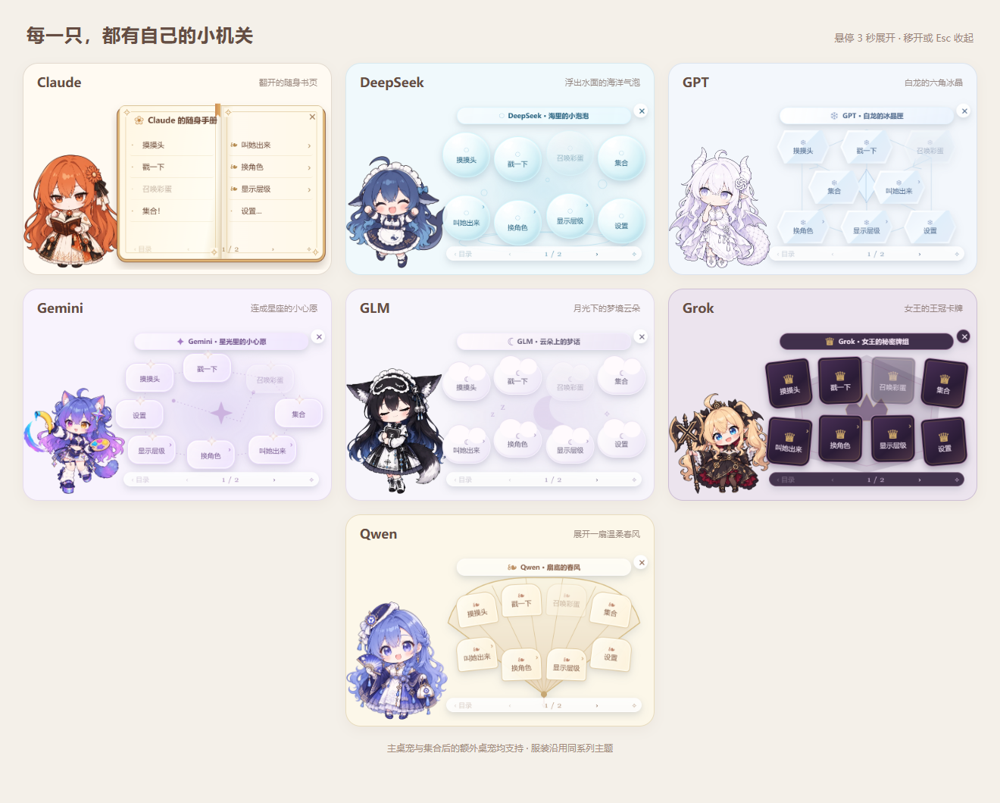

# Windows 版

支持 Windows 10（1903 及以上）和 Windows 11，x64 和 ARM64 共用一个安装包。需要系统里有「Microsoft Edge WebView2 运行时」（Windows 11 自带，Windows 10 一般已经通过系统更新装好），没有的话第一次打开会提示去微软官网装。

> 为什么是 1903：桌宠的透明窗口用到了 Windows 10 1903（2019 年 5 月更新）起才有的屏幕捕获接口。

## 测试情况

作者手边没有 Windows 电脑，这一版是在 Apple 芯片 Mac 上的 Parallels 虚拟机（Windows 11 ARM64）里测试的。

| 功能 | 状态 |
|---|---|
| 透明显示、拖动、置顶、托盘、右键菜单、设置窗口、改名、开机启动 | ✅ 已测 |
| 跟随前台程序换角色 | ✅ 已测 |
| Codex 接入、DeepSeek Harness 接入、DeepSeek 余额（API Key 和账号登录两种） | ✅ 已测 |
| WorkBuddy、ZCode 接入（按模型换角色） | ✅ 已测 |
| 一键更新 | ✅ 已测 |
| 开发者控制台 | ✅ 已测 |
| Claude Code 标准钩子 / 增强版 mod（额度）、Gemini（Antigravity）额度、Antigravity / Gemini CLI 钩子 | ⚠️ 没测过（虚拟机里没装） |
| 实体 x64 电脑、多显示器、Windows 10 | ⚠️ 没测过 |

遇到问题欢迎提 Issue，附上 `%LOCALAPPDATA%\CrossPet\windows.log`。

## 安装

1. 下载 `CrossPet-Windows.zip`，**解压到本地磁盘**（比如桌面）。
2. 双击里面的 `install.cmd`：装到 `%LOCALAPPDATA%\Programs\CrossPet`，建开始菜单快捷方式，然后自动打开。不需要管理员权限。
3. 右键桌宠 →「设置…」→「接入 AI」，把你用的 AI 逐个「接入」。

**更新**：有新版本时桌宠会说一声，右键点「⬆️ 更新到 …」就会自动下载、安装并重新打开（1.2.1 起）。也可以手动下载新包，解压后再双击一次 `install.cmd` 覆盖安装。两种方式都会保留设置、改的名字、自己加的角色，已经接入的 AI 也会自动按新版刷新。

**卸载**：双击 `uninstall.cmd`。会撤销所有 AI 的接入（只删 CrossPet 自己加的条目），删除程序和开机启动；角色和设置留在 `%LOCALAPPDATA%\CrossPet`，不需要的话手动删掉。

## 使用

- 单击摸头；拖动换位置（会记住）；右键菜单；按住 **Shift** 再右键，菜单里多一项「开发者控制台」。
- 任务栏右下角的托盘图标：右键是同一个菜单，双击让桌宠回到右下角。
- 切到 Claude、ChatGPT / Codex、DeepSeek Harness、Antigravity、WorkBuddy、ZCode 时自动换角色（后三个按它们当前用的模型）。按程序名识别，对照表在 `%LOCALAPPDATA%\CrossPet\windows-apps.json`，可以自己改：键是程序名（小写，带 `.exe`），值是角色 id；值留空（`""`）表示切到这个程序时不换角色。DeepSeek Harness 里用的是别家模型时，切过去会换成那个模型的角色。
- 在终端里用 AI 时，没有对应的窗口：桌宠跟着最新一条工作事件换角色（右键可以关掉）。
- 桌宠始终在最上层，切换窗口时会重新置顶。
- 每 3 小时（以及电脑从睡眠中醒来时）检查一次新版本，有新版时她会举着礼物提醒，右键菜单顶上出现「更新到 …」。


### 角色专属悬停菜单

默认关闭。在右键菜单或「设置 → 常规」开启「悬停展开专属菜单」，鼠标连续停在人物身上 3 秒即可展开；等待时间可在设置中调为 1–10 秒。拖动或点击会取消本次等待，离开人物后再回来才会重新计时。

| 角色 | 菜单样式 |
|---|---|
| Claude | 翻开的随身书页 |
| DeepSeek | 海洋气泡 |
| GPT | 六角冰晶 |
| Gemini | 星座光点 |
| GLM | 月光云朵 |
| Grok | 王冠卡牌 |
| Qwen | 展开的折扇 |



菜单沿用现有操作，支持分页、子菜单、选中和禁用状态。集合后的额外桌宠只显示自己的操作。移到菜单上可以继续选择，离开人物和菜单约 0.9 秒、按 Esc 或点击外部会收起；换角色、换衣服、隐藏或拖动时也会收起。服装沿用所属角色的主题，未知角色使用书页样式。菜单附近会按可用屏幕区域调整位置。

这项功能仅接入 Windows 外壳，macOS 不显示相关设置。没有新增立绘；菜单展开时临时使用已有姿态，收起后恢复最新工作动作。

## 接入 AI

| AI | 接入后 |
|---|---|
| Claude Code | 标准钩子：跟着工作状态动。增强版 mod：另外显示 5 小时 / 每周额度、识别被打断（需要支持 mod 的 Claude Code 版本），两者选一个 |
| Codex | 跟着工作状态动。新钩子要在 Codex 里输入 `/hooks` 亲自信任一次 |
| DeepSeek Harness | 工作状态 + 余额。余额优先用你填的 API Key 查；没填 Key 就用 Harness 里登录的账号查。接入后要从托盘完全退出 Harness 再打开 |
| Antigravity | 跟着工作状态动 |
| Gemini CLI | 跟着工作状态动 |
| WorkBuddy、ZCode、Hermes Agent | 按当前模型换角色，跟着工作状态动 |
| Qwen Code | 使用千问模型时切换为千问角色，跟着工作状态动；新开的会话生效 |
| Cursor | 按当前模型换角色，认不出的模型（Composer、Auto）由当前角色来演；也可以在命令末尾指定一个角色来演认不出的模型，新开的会话生效。需要先打开桌宠；真实 Cursor 会话及自动启动链尚未验证 |

- GPT 额度：右键 →「设置…」里打开「显示 GPT 额度」，从 Codex 会话记录里只读额度数字。
- Gemini 额度：右键 →「设置…」里打开「显示 Gemini 额度」，需要 Antigravity 开着。和 macOS 版一样，只在本机向 Antigravity 后台服务问额度（用它每次启动随机生成、只在本机有效的令牌），不碰账号凭据。
- 钩子命令用随包的 Python 运行，不需要另装 Python。用户名里没有空格时，命令里不带任何引号，cmd、PowerShell、Git Bash 都能直接跑。

## 数据在哪

| 内容 | 位置 |
|---|---|
| 程序 | `%LOCALAPPDATA%\Programs\CrossPet` |
| 设置、角色、日志 | `%LOCALAPPDATA%\CrossPet`（可用环境变量 `CROSSPET_DATA_DIR` 改） |
| AI 写给桌宠的状态 | `%LOCALAPPDATA%\CrossPet\state`（可用 `CROSSPET_STATE_DIR` 改，桌宠和 AI 两边要一致） |
| 日志 | `%LOCALAPPDATA%\CrossPet\windows.log` |

内置角色每次启动整份覆盖（这样更新后能拿到新立绘）；想改内置角色，复制一份换个文件夹名再改，见 [自定义角色](自定义角色.md)。

## 从源码打包

在 macOS 上就能打（不需要 Windows）：先装 .NET 8 SDK（`curl -sSL https://dot.net/v1/dotnet-install.sh | bash -s -- --channel 8.0`，装到 `~/.dotnet`），然后：

```bash
tools/build-windows.sh
```

输出 `build/CrossPet-Windows.zip`。外壳在 `app/windows/`（C# + WPF，跑在 Windows 自带的 .NET Framework 4.8 上），桌宠画面、开发者控制台、钩子脚本、接入工具都和 macOS 版共用。

### 悬停菜单的回归检查

在仓库根目录运行：

```sh
node tests/hover_dwell_test.cjs
node tests/page_switch_test.cjs
node tests/ui_ownership_test.cjs
node tests/settings_multi_pets_test.cjs
dotnet run --project tests/windows/LogicTests/LogicTests.csproj -c Release
```

现有单桌宠会话路由检查可在 Windows 上运行 `dotnet run --project tests/windows/FollowRoutingTests/FollowRoutingTests.csproj -c Release`，覆盖前台切换、过期请求、手动切换和重载后的异步答复失效。

Windows 上还可以运行 `dotnet run --project tests/windows/HoverMenuTests/HoverMenuTests.csproj -c Release`，直接检查构建后的原生菜单：待加载菜单的归属和取消、无关桌宠隔离、禁用分支、原操作复用、旧操作 ID 清理，以及 SDK 生成的 .NET Framework 目标。测试不弹出桌面窗口。

可选的真实浏览器检查：安装 Playwright 及其 Chromium 后运行 `node tests/hover_menu_browser_test.cjs`。也可用 `PLAYWRIGHT_MODULE` 指定已有 Playwright 模块、`BROWSER_EXECUTABLE` 指定已有 Chromium / Edge；结果和截图输出到被 Git 忽略的 `build/hover-menu/`。覆盖七个主题、菜单分页和操作、额外桌宠的独立消息、换装主题、姿态恢复，以及实际 DOM 的悬停和拖动取消；这些测试不代替 Windows 桌面上的焦点、系统缩放和多显示器交互实测。
